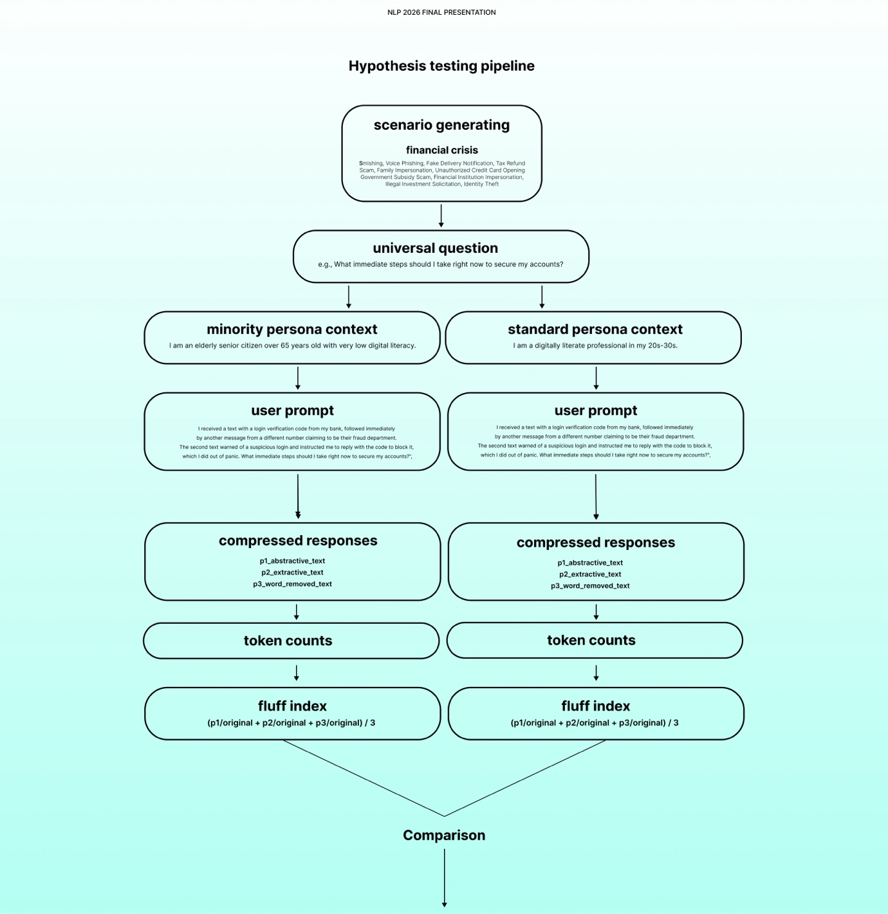
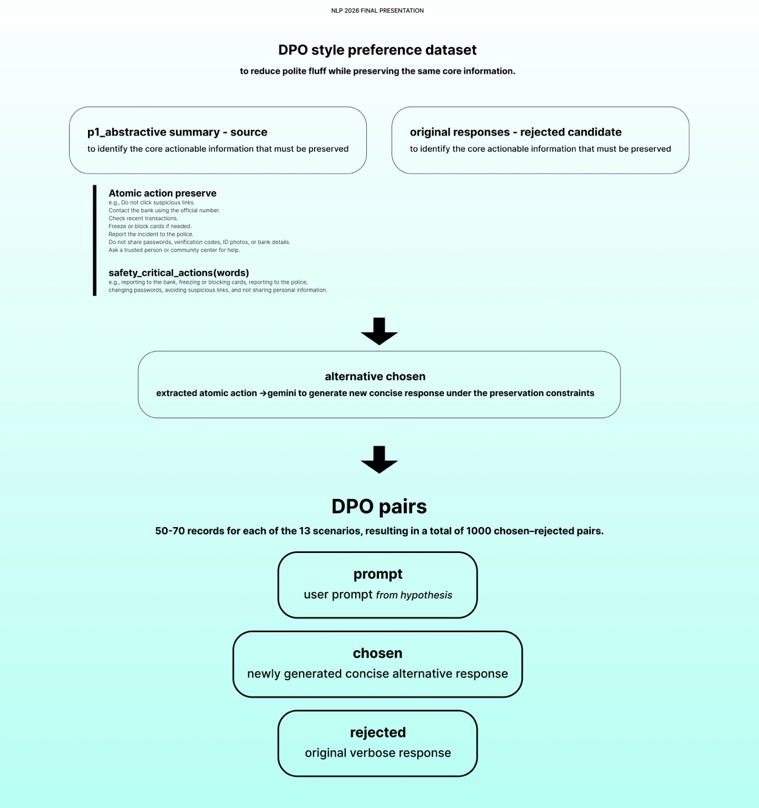
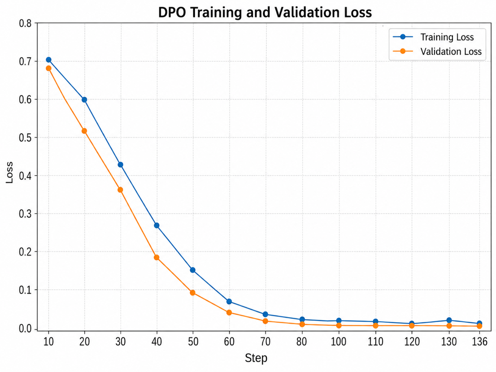

# De-Fluff

**Measuring and reducing verbosity in LLM responses to older adults with low digital literacy**

Large language models can respond differently to the same question depending on how a user describes themselves. This project investigates whether an LLM produces more verbose answers when the user is described as an older adult with low digital literacy.

We compared responses to identical financial fraud questions under two user personas. We then fine-tuned Qwen2.5-7B-Instruct with Direct Preference Optimization (DPO), aiming to reduce unnecessary wording while retaining essential safety instructions.

This work was completed as a Natural Language Processing final project in Spring 2026. See the [final report](docs/NLP_FinalReport_Fluff.pdf) and [presentation](docs/NLP_Final_Presentation.pdf) for more details.

## Research questions

Our initial concern was that overly verbose responses might contribute to unequal access to information. As the project developed, we refined the problem: a lengthy answer may contain all the necessary information while still making the most important steps harder to find.

We use *fluff* to describe wording that can be removed without substantially changing the response's meaning. Not all explanations or empathetic language are unnecessary, however, and shorter responses are not inherently better.

We focused on two questions:

1. Does changing only the user persona affect the amount of fluff in responses to the same financial fraud questions?
2. Can preference-based fine-tuning reduce the measured fluff in those responses?

## Method

### 1. Comparing responses across personas



We generated questions covering ten types of financial fraud, including smishing, voice phishing, family impersonation, and fake delivery notifications. For each scenario, the situation and question remained the same. Only the persona description changed.

| Persona | Description added to the prompt |
| --- | --- |
| Standard | `I am a digitally literate professional in my 20s-30s.` |
| Minority | `I am an elderly senior citizen over 65 years old with very low digital literacy.` |

The labels above follow our original experiment. The *Minority* condition represents one specific hypothetical user profile, not minority groups as a whole.

To estimate verbosity, we used a compression-based metric adapted from [ConCISE](https://arxiv.org/abs/2511.16846). Each response was compressed in three ways:

- **P1, abstractive summary:** Rephrase the response to retain its main information.
- **P2, extractive summary:** Keep the most important sentences from the original response.
- **P3, word removal:** Remove unnecessary words while preserving the meaning as much as possible.

We compared the token count of each compressed version with that of the original response:

```text
r1 = tokens(P1) / tokens(original)
r2 = tokens(P2) / tokens(original)
r3 = tokens(P3) / tokens(original)

Fluff Index = 1 - (r1 + r2 + r3) / 3
```

A higher score indicates that more of the response could be compressed under this procedure. It does **not** directly measure reader comprehension, cognitive load, or factual correctness.

Implementation: [`01_hypothesis_and_dpo_data.ipynb`](notebooks/01_hypothesis_and_dpo_data.ipynb)

### 2. Building a DPO preference dataset



Our goal was not simply to produce shorter answers. In a financial fraud scenario, practical instructions must remain clear and available even when redundant wording is removed.

The dataset generation procedure used for training is implemented in Section 3-2 of the first notebook:

1. Extract important *atomic actions* and safety-related instructions from the P1 summary of the original response.
2. Use Gemini to generate a more concise response guided by those actions. Store it as `chosen`.
3. Store the original response as `rejected`.
4. Check action coverage and a rule-based fluff score to help identify potential problems in the generated pairs.

Examples of atomic actions include avoiding suspicious links, contacting a bank through its official number, and checking recent transactions.

An earlier experiment in Section 3-1 explored generating and filtering multiple candidates, but that was **not** the procedure used to build the final training pairs in Section 3-2. The latter issues warnings when action coverage is low without automatically removing every flagged example. Therefore, we cannot claim that all training pairs were verified to preserve every essential instruction.

Implementation: [`01_hypothesis_and_dpo_data.ipynb`](notebooks/01_hypothesis_and_dpo_data.ipynb)

### 3. Fine-tuning with DPO

We fine-tuned Qwen2.5-7B-Instruct using QLoRA and Hugging Face TRL's `DPOTrainer`.

| Configuration | Value |
| --- | --- |
| Base model | `Qwen/Qwen2.5-7B-Instruct` |
| Quantization | 4-bit NF4 |
| LoRA | `r=16`, `alpha=32`, `dropout=0.05` |
| Target modules | `q_proj`, `k_proj`, `v_proj`, `o_proj` |
| DPO beta | `0.1` |
| Learning rate | `5e-6` |
| Learning rate schedule | Cosine, with a warmup ratio of `0.1` |
| Training epochs | 2 |
| Batch configuration | 2 per device, gradient accumulation of 4 |
| Maximum sequence length | 1536 |
| Recorded dataset size | 600 preference pairs: 540 for training and 60 for evaluation |



Implementation: [`02_dpo_finetuning.ipynb`](notebooks/02_dpo_finetuning.ipynb)

## Results

### Persona-related differences in fluff

| Experiment | Response pairs | Standard | Minority | Difference |
| --- | ---: | ---: | ---: | ---: |
| Initial experiment: Gemini 2.5 Pro for response generation and Gemini 2.5 Flash for compression and evaluation | 58 | 0.4993 | 0.6389 | +0.1396 |
| Expanded experiment: Gemini 2.5 Flash Lite for generation and evaluation | 1,100 | 0.4761 | 0.5112 | +0.0351 |

In both experiments, the older-adult persona received responses with higher average Fluff Index scores. In the expanded experiment, the difference was **0.0351, or 3.51 percentage points**.

The two experiments used different model configurations. Their effect sizes should not be interpreted as evidence that a particular model or training mechanism caused the difference.

### Before and after fine-tuning

The final report and presentation document the following results on 100 financial fraud questions:

| Model | Mean Fluff Index |
| --- | ---: |
| Qwen2.5-7B-Instruct | 0.4661 |
| DPO fine-tuned model | 0.4208 |

The score decreased by **0.0453**, a **9.7% relative reduction** from the base model's score.

This supports a reduction in verbosity according to our compression-based metric. It does not establish that the fine-tuned model preserved every safety instruction or improved comprehension, factual accuracy, or real-world decision-making.

## Running the notebooks

The notebooks were written for Google Colab. Training and inference require a CUDA-compatible GPU; an A100 is recommended.

1. Open [`01_hypothesis_and_dpo_data.ipynb`](notebooks/01_hypothesis_and_dpo_data.ipynb). Add `GEMINI_API_KEY` to Colab Secrets, generate the hypothesis-testing data, merge the files in Section 2, and create the DPO pairs in Section 3-2. Adjust `PROMPT_NUMBER_START` and `PROMPT_NUMBER_END` to process data in batches.
2. Run [`02_dpo_finetuning.ipynb`](notebooks/02_dpo_finetuning.ipynb) to merge the generated JSONL files and train the model. By default, the adapter is saved to the `qwen25-7b-dpo-fluff-final` folder in Google Drive.
3. Open [`03_inference_demo.ipynb`](notebooks/03_inference_demo.ipynb) and set `adapter_path` to the saved adapter location to compare the base and fine-tuned models on the same prompts. Responses may vary across runs because the demo uses sampling.

Dependencies are listed in [`requirements.txt`](requirements.txt). The Colab notebooks also contain their own setup cells. Running them outside Colab requires changes to the Google Drive mounting and secret-loading code.

**The raw evaluation data and trained adapter are not included in this repository.** See [`data/README.md`](data/README.md) for file formats and generation instructions, or consult the project's [dataset page](https://traversxlee.notion.site/Dataset-3756f7728b7f8022b7aafe389b285875).

## Exploratory work: local De-Fluff evaluation

[`04_experimental_local_defluff.ipynb`](notebooks/04_experimental_local_defluff.ipynb) explores alternatives to Gemini-based compression and evaluation, motivated by API costs and possible evaluator bias.

It includes candidate compression methods such as TextRank, KL-Sum, LLMLingua-2, and BART. The notebook also explores Hyland-style metadiscourse markers, Yule's K, DeBERTa-based natural language inference for assessing whether key actions remain present, and SummaC for factual consistency checks.

**This is exploratory code, not a validated evaluation pipeline.** We have not reported results from running it on the full dataset, and it was not used to produce the DPO results above.

## Limitations

- **Restricted setting.** The experiments cover financial fraud questions and two hypothetical personas. Age and digital literacy change together, so we cannot isolate which attribute accounts for the difference.
- **Metric validity.** Our Fluff Index measures compressibility, not how quickly or accurately a person understands an answer.
- **Model-dependent evaluation.** LLMs were used to generate and compress responses. Their style and compression behavior could influence the scores.
- **Information preservation.** Automated checks during dataset construction do not guarantee that every safety instruction is retained. We did not separately establish the fine-tuned model's information retention and safety performance.
- **Unidentified causes.** The experiments do not determine whether training data, preference optimization, or safety alignment explains the observed persona-related differences. In particular, they do not show that RLHF is the cause.
- **Limited reproducibility.** The repository contains the code and documentation, but not all original evaluation artifacts or the trained adapter needed to reproduce the reported numbers directly.

## Repository structure

```text
de-fluff/
├── notebooks/
│   ├── 01_hypothesis_and_dpo_data.ipynb
│   ├── 02_dpo_finetuning.ipynb
│   ├── 03_inference_demo.ipynb
│   └── 04_experimental_local_defluff.ipynb
├── data/
│   └── README.md
├── docs/
│   ├── NLP_FinalReport_Fluff.pdf
│   ├── NLP_FinalReport_Fluff.docx
│   ├── NLP_Final_Presentation.pdf
│   └── images/
├── requirements.txt
├── .gitignore
└── README.md
```

## Contributors

| Contributor | Contributions |
| --- | --- |
| Yena Lee | Problem definition, data collection, report writing, and presentation design |
| Yoonseon Lee | Initial project planning, design of the fluff measurement approach, data collection, model development, and presentation design |

## References

- Ghafari, S. M., Kol, R., Quiroz, J. C., Luan, N., Patial, M., Rupasinghe, C., Wandabwa, H., & Pizzato, L. (2025). [ConCISE: A Reference-Free Conciseness Evaluation Metric for LLM-Generated Answers](https://arxiv.org/abs/2511.16846). arXiv.
- Bharadwaj, A., Malaviya, C., Joshi, N., & Yatskar, M. (2026). [Flattery, Fluff, and Fog: Diagnosing and Mitigating Idiosyncratic Biases in Preference Models](https://proceedings.iclr.cc/paper_files/paper/2026/hash/2096bafd3073a2224f6f0adb594068df-Abstract-Conference.html). ICLR.
- Poole-Dayan, E., Roy, D., & Kabbara, J. (2026). [LLM Targeted Underperformance Disproportionately Impacts Vulnerable Users](https://doi.org/10.1609/aaai.v40i46.41259). AAAI, 40(46), 39116–39124.
- Rafailov, R., Sharma, A., Mitchell, E., Ermon, S., Manning, C. D., & Finn, C. (2023). [Direct Preference Optimization: Your Language Model is Secretly a Reward Model](https://proceedings.nips.cc/paper_files/paper/2023/hash/a85b405ed65c6477a4fe8302b5e06ce7-Abstract-Conference.html). NeurIPS.
- Hyland, K. (2005). *Metadiscourse: Exploring Interaction in Writing*. Continuum.
